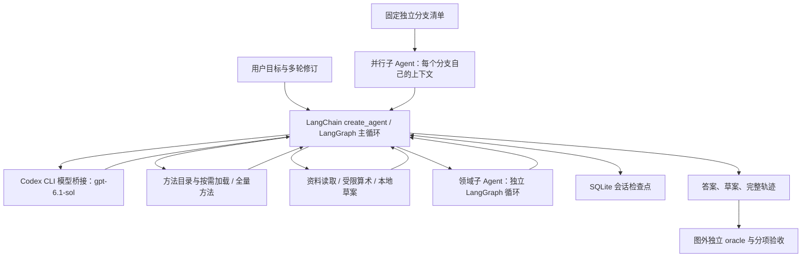

# 困难场景实践：LangGraph 中的知识、上下文与工具边界

本轮在原项目扩展，保留旧实验、失败和冻结源码。设计见 [HARD-SPEC](../../HARD-SPEC.md)，正式配置见 [HARD-MATRIX](../../HARD-MATRIX.md)。时间从2026-11-06延续到11-07。

## 实际运行结构



主循环和每个子Agent都是真实LangGraph执行。领域委派在主图的工具节点内调用子图；独立审计的fan-out由Python线程池按case分支清单调度，并非模型自动找到了最佳拆分。LangGraph不提供业务知识或最优答案，它负责消息状态与工具循环。

模型仍走同一CLI结构化桥接；它只选择给定业务工具，不能使用shell、读测试文件或调用oracle。本轮是文章机制的跨模型实践，不是Anthropic企业部署或Claude原生SDK性能复现。

## 各组到底差在哪里

| 配置 | 上下文 | 方法知识 | 写入者 |
|---|---|---|---|
| tools | 一个主上下文 | 可查询同样事实和政策，无待测流程包 | 主Agent |
| eager | 一个主上下文 | 当前库全部流程正文 | 主Agent |
| skills | 一个主上下文 | 名称/描述，正文按需返回同一上下文 | 主Agent |
| domain | 协调者与领域专家独立 | 专家方法、同一资料和全部用户修订 | 协调者 |
| audit_single | 一个主上下文 | 与context工作者相同的审计方法 | 主Agent |
| context | 每个分支独立上下文，再汇总 | 同一审计方法，没有额外Skill菜单 | 汇总主Agent |

所有组都能获得相同的业务事实和规则。oracle不会作为工具暴露，草案工具不会替模型计算最优方案。独立审计的比较采用audit_single/context控制知识差异，tools仅作为额外知识消融。

## 难度与测量

组合问题含216或1296个原始组合，过滤兼容、库存和时间后仍有多个可行方案。模型需要比较非线性的仓库折扣、运费与现金抵扣；评分分开记录可行、最优、金额正确和完整交付。

多轮任务在同一个图会话中修改条件，原始case快照不会自动变成最新需求。只检查最后方案和提交时机；前两轮分析内容不是完整评测对象。

审计要按时点截断后选择每个分支/ref的最新版本，去重、处理撤销和待核异常。compact只移除observability字段，行集合及所有业务字段保持一致。它是声明契约下的无损字段投影，不是LLM摘要，也不是提前算答案。

小知识库含3份核心方法，压力库为同样核心方法加21份不同职责的长尾流程，共24份。数据是合成、可控的，不代表某家企业的真实文档分布。

## 运行

```bash
uv run --frozen --extra dev pytest -q

# 同题四方案，两次重复；会消耗真实模型计划额度。
uv run --frozen python -m loop_lab.hard.run \
  --output runs/my-hard-core --cases P1 P2 P3 P4 R1 R2 \
  --variants tools eager skills domain --reps 2 --jobs 4 \
  --max-calls 380 --max-tokens 6500000

# 知识库规模。
uv run --frozen python -m loop_lab.hard.run \
  --output runs/my-large-library --cases P1 P2 P3 P4 \
  --variants eager skills --library large --jobs 4

# 等知识的独立上下文对照；可将raw替换为compact。
uv run --frozen python -m loop_lab.hard.run \
  --output runs/my-audit --cases A1 A2 \
  --variants tools audit_single context --representation raw --jobs 1
```

每个输出目录同时包含原始模型请求/响应、用量、草案、来源读取与委派轨迹、数据与评分预期、源码完整快照。`HARD-REPORT.md`给分项结果，`REPORT.md`给标准逐题结果；没有运行/预算中断的情况单列。

## 接线阶段的审查与修正

- 独立审查使用另外的实现重算P1、P3、A1，最优解与审计真值一致。
- 增加audit_single，消除“context有审计方法而tools没有”的知识混杂。
- 所有审计组一致接收廉价case简介，避免只有fan-out方案省去初始查询。
- 草案输入采用普通JSON对象，消除双重JSON字符串转义带来的多余修复回合。
- 计算器保留数字原文、限制AST深度；模型并发参数在启动前验证为1–4。
- 小数/深度、资料无损投影、过期revision、虚报金额、过早提交和事后补证据均有公开边界测试。

这些接线修正发生在正式矩阵冻结前。接线样本的耗时不混入正式方案排名。

## 当前解释纪律

领域委派若耗尽共享调用预算，属于该配置未能在给定资源内交付；不自动证明专家不知道正确方案。额外验证、重复读取和职责描述含糊要分别从轨迹定位。

同样，若所有组都达到最优，只能说该难度和模型下未检出质量差异；仍可比较代价，但不能把零差异当作普遍等效。对模型失败的后续修正需新版本和新的同族实例，不覆盖已冻结结果。
